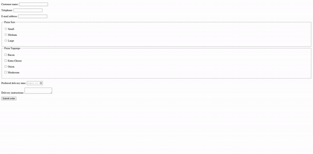
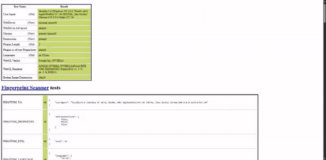
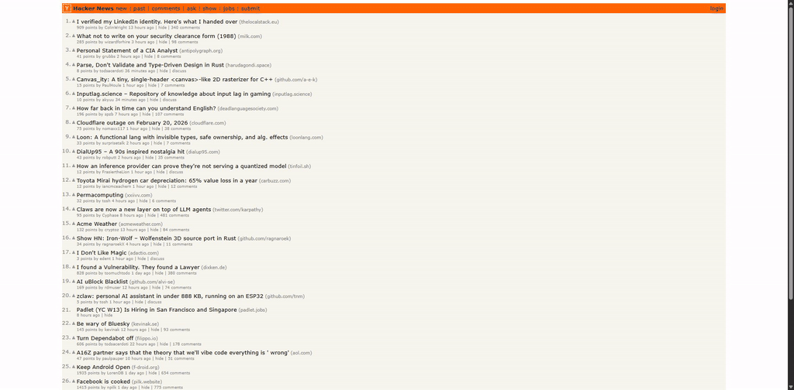
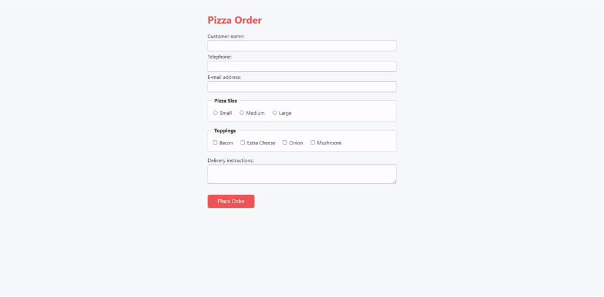
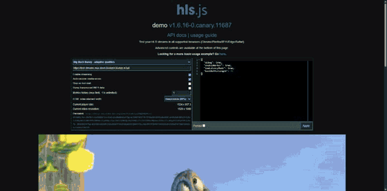

<p align="center">
  
</p>

<p align="center">
  <em>Automate any website by describing what you want in plain English.<br>
  No web development knowledge required.</em>
</p>

<p align="center">
  
</p>

---

Most browser plugins let Claude interact with pages you already understand. Otto is built for the opposite scenario: enterprise portals, vendor dashboards, and third-party sites where you don't control the HTML, the page actively resists automation, and you need a script that runs unattended -- without Claude in the loop.

Otto is a [Claude Code](https://docs.anthropic.com/en/docs/claude-code) plugin. You describe a task conversationally -- *"log into the portal, navigate to Reports, export the CSV"* -- and Claude scouts the page structure, drives a stealth browser through the workflow, and exports a standalone Python script you can run on a schedule. Built on [Botasaurus](https://github.com/omkarcloud/botasaurus) for fingerprint evasion, so the sites that block Playwright and Puppeteer don't block Otto.

## Why Otto?

|   | Otto | Dev-Browser | Chrome Extension MCP | Playwright MCP |
| --- | --- | --- | --- | --- |
| **Anti-detection** | Botasaurus stealth fingerprinting | Playwright (detectable) | Browser extension (detectable) | Playwright (detectable) |
| **Bot check score** | Passes sannysoft, creepjs | Fails common checks | N/A | Fails common checks |
| **Page discovery** | Compact scout reports (~200 tokens) | You provide selectors | You provide selectors | You provide selectors |
| **Credential safety** | Never appears in conversation | Plaintext in context | Plaintext in context | Plaintext in context |
| **XHR interception** | Built-in network monitor with filtering | No | No | Limited |
| **Video recording** | CDP screencast to MP4 | No | No | Built-in |
| **Export to script** | One command, runs unattended | No | No | No |
| **Best for** | Complex enterprise portals | Testing your own app | Interactive debugging | Cross-browser test suites |

<p align="center">
  
  <br><em>Otto passes every bot detection test on sannysoft.com — 51 tests, 0 failures.</em>
</p>

## The Problem

Enterprise portals are tough terrain for automation. The login form lives inside a triple-nested iframe. The export button triggers an XHR that returns a signed URL. The page fingerprints your browser and blocks anything that smells like Playwright.

Otto handles all of this so you don't have to. Claude scouts the page, discovers selectors from reconnaissance rather than guesswork, drives the workflow step by step, and exports a production-grade script -- no web development knowledge required.

> **New here?** The [Getting Started guide](docs/getting-started.md) walks through a complete example from scout to scheduled script.

## Install

### Prerequisites

Before installing Otto, make sure you have:

1. **[Claude Code](https://docs.anthropic.com/en/docs/claude-code)** -- Otto is a Claude Code plugin
2. **Python 3.11+** -- check with `python --version`
3. **[uv](https://docs.astral.sh/uv/)** -- Python package manager used by the MCP server (`pip install uv` or see [install docs](https://docs.astral.sh/uv/getting-started/installation/))
4. **Google Chrome or Chromium** -- Botasaurus drives it via Chrome DevTools Protocol

### Step 1: Add the marketplace

In Claude Code, run:

```
/plugin marketplace add stemado/otto-marketplace
```

This registers the Otto plugin catalog. You only need to do this once.

### Step 2: Install the plugin

```
/plugin install otto@otto-marketplace
```

### Step 3: Restart Claude Code

Restart your Claude Code session to load the MCP server. You should see Otto's tools available (try asking Claude to "scout a website").

### Updating

```
/plugin update otto@otto-marketplace
```

Then restart Claude Code to pick up the new version.

### What gets installed

- **11 MCP tools** for browser automation (scout, click, type, monitor network, etc.)
- **2 slash commands** -- `/scout <url>` and `/export-workflow [name]`
- **1 skill** -- Otto responds to phrases like "automate this site", "scout this page", "build a bot"
- Python dependencies (`botasaurus-driver`, `mcp`, `pydantic`, `python-dotenv`) are installed automatically by `uv` on first run

## Usage

Describe what you want automated:

> "Scout the login page, log in with the credentials in .env, navigate to Reports > Export, and download the CSV."

Claude launches a stealth browser, scouts the page, drives through the workflow, and exports a standalone script when done. You watch it work and redirect as needed -- the same way you'd pair-program with a colleague who happens to have a browser open.

### `/scout <url>`

Launch a stealth browser and get a structural overview of any page: iframe hierarchy, shadow DOM boundaries, interactive element counts. The session stays alive for follow-up interactions.

```
/scout https://example.com/portal/login
```

<p align="center">
  
  <br><em>Compact structural overview in ~200 tokens — not a raw DOM dump.</em>
</p>

### `/export-workflow [name]`

After completing a workflow interactively, export it as a replayable script. Produces two files in `workflows/`:

- A standalone Python script with numbered, commented steps
- A portable JSON workflow definition (replayable via `workflow-run`)

Credentials are automatically parameterized -- real values never appear in the output.

```
/export-workflow portal-report-download
```

### Video Recording

Record your browser session as an MP4 video. Uses Chrome's CDP screencast to capture frames, then encodes with ffmpeg on stop.

```
record_video start    # begin recording (1280x720 @ 10fps)
# ... interact with the page ...
record_video stop     # stop, encode, return file path
record_video status   # check frame count and elapsed time
```

Parameters: `max_width`, `max_height`, `quality` (1-100), `target_fps` (1-30). A 5-minute safety timer auto-stops runaway recordings.

**Encoding** requires ffmpeg. Install via the optional extra (`pip install otto[video]` for a bundled ffmpeg binary) or have `ffmpeg` on your system PATH. Without ffmpeg, frames are saved as numbered JPEGs and the directory path is returned.

### `workflow-run`

Replay an exported workflow without Claude in the loop. Intended for schedules, CI pipelines, and cron jobs.

```
workflow-run workflows/portal-report-download.json \
  --var USERNAME=admin --var PASSWORD=s3cret
```

Variables resolve from CLI args first, then environment variables, then workflow defaults. Credential values are masked in all output.

```
workflow-run workflows/my-workflow.json --dry-run    # validate and print plan
workflow-run workflows/my-workflow.json --headless   # run without a visible browser
```

Each step emits a JSON log line to stdout. Exit codes: `0` success, `1` step failure, `2` validation error.

## MCP Tools

Otto exposes 12 tools via MCP, organized by function:

**Session lifecycle** -- `launch_session` . `close_session` . `get_session_history`

**Reconnaissance** -- `scout_page_tool` . `find_elements` . `inspect_element` . `take_screenshot`

**Interaction** -- `execute_action_tool` . `fill_secret` . `execute_javascript`

**Observation** -- `monitor_network` . `record_video`

| Tool | Purpose |
|------|---------|
| `launch_session` | Open a stealth browser with optional URL, proxy, and headless mode |
| `scout_page_tool` | Structural page overview: metadata, iframes, shadow DOM, element counts |
| `find_elements` | Search for interactive elements by text, type, or CSS selector |
| `execute_action_tool` | Perform a single action: click, type, select, navigate, scroll, hover |
| `fill_secret` | Type a credential from `.env` into a form field without exposing it |
| `execute_javascript` | Run arbitrary JS in the page context |
| `take_screenshot` | Capture a screenshot for Claude to inspect visually |
| `inspect_element` | Deep-inspect a DOM element: visibility, overlays, shadow DOM, ARIA |
| `monitor_network` | Capture network traffic, filter by URL pattern, wait for downloads |
| `record_video` | Record the browser screen to MP4 via CDP screencast |
| `get_session_history` | Retrieve the full structured action history of the session |
| `close_session` | Close the browser and release resources |

### Credential Handling

`fill_secret` injects credentials from your `.env` file directly into form fields. The actual value never appears in the conversation -- Claude only sees a confirmation like `"chars_typed": 22`. Session history stores `${APP_PASSWORD}` references, not real values, so exported scripts are safe to commit.

<p align="center">
  
</p>

## Network Interception

Otto's `monitor_network` tool captures XHR, Fetch, and other requests in real time with URL pattern filtering. This is how Otto handles sites that hide media behind blob URLs, trigger downloads via signed URLs, or make API calls that you need to replay in your automation script.

<p align="center">
  
  <br><em>Video plays from a blob: URL — Otto catches the real .m3u8 and .ts segment URLs behind the scenes.</em>
</p>

## When to Use What

Several tools give Claude browser access. They solve different problems.

**Otto** is for automating sites you don't control -- enterprise portals, HR systems, vendor dashboards -- where the HTML is opaque, anti-bot detection is present, and you want a script that runs unattended. Otto discovers page structure for you, handles stealth, and exports standalone workflows.

**[Dev-Browser](https://github.com/anthropics/claude-code-plugins)** is for testing your own application during development. You provide the selectors; it drives Playwright against known HTML.

**[Chrome Extension MCP](https://docs.anthropic.com/en/docs/claude-code/mcp)** is for interactive debugging and inspection. It operates inside your real browser session -- useful when you're already looking at the page and want Claude to help you understand or manipulate it.

**[Playwright MCP](https://browsermcp.io/)** is for cross-browser test automation. You provide selectors and assertions; it runs deterministic test suites across engines.

## License

MIT
