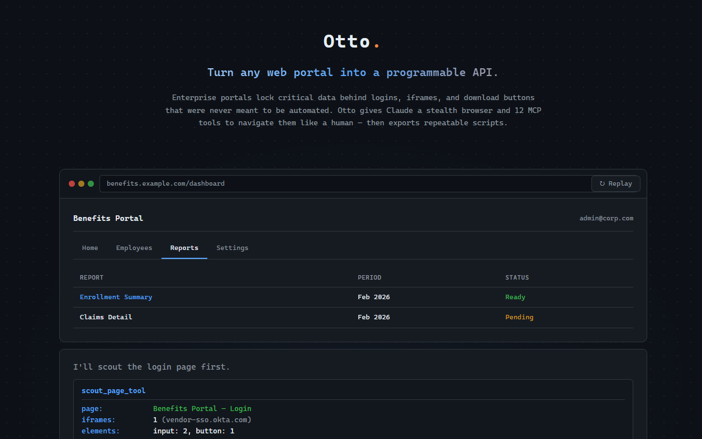
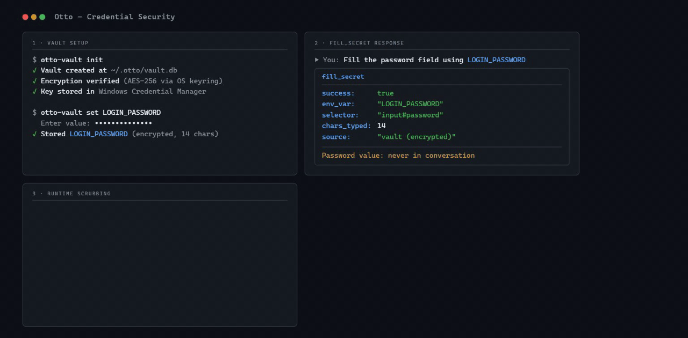

<p align="center">
  
</p>

<p align="center">
  <em>Turn any web portal into a programmable API.<br>
  No web development knowledge required.</em>
</p>

<p align="center">
  <a href="https://stemado.github.io/otto/showcase.html">
    
  </a>
  <br><em><a href="https://stemado.github.io/otto/showcase.html">Interactive showcase &rarr;</a></em>
</p>

---

Every enterprise has systems that were never designed to be automated -- vendor dashboards, HR portals, benefits platforms, internal tools locked behind logins with no API in sight. Otto fills that gap.

Otto is a [Claude Code](https://docs.anthropic.com/en/docs/claude-code) plugin. You describe a task conversationally -- *"log into the portal, navigate to Reports, export the CSV"* -- and Claude scouts the page structure, drives the browser through the workflow, and exports a standalone Python script that runs unattended. It conforms to whatever interface it encounters and produces a replayable automation that behaves like the API that should have existed all along.

## Why Otto?

|   | Otto | Dev-Browser | Chrome Extension MCP | Playwright MCP |
| --- | --- | --- | --- | --- |
| **Works on portals you don't control** | Yes -- enterprise portals, vendor dashboards, HR systems | Limited -- designed for your own app | Limited -- your active browser session | Limited -- designed for your own app |
| **Page discovery** | Compact scout reports (~200 tokens) | You provide selectors | You provide selectors | You provide selectors |
| **Credential safety** | Never appears in conversation | Plaintext in context | Plaintext in context | Plaintext in context |
| **XHR interception** | Built-in network monitor with filtering | No | No | Limited |
| **Export to script** | One command, runs unattended | No | No | No |
| **Encrypted credentials** | Vault with OS keyring | No | No | No |
| **Credential scrubbing** | Automatic in all output | No | No | No |
| **Video recording** | CDP screencast to MP4 | No | No | Built-in |
| **Dependency pre-checks** | SessionStart hook | No | No | No |
| **Best for** | Enterprise systems without APIs | Testing your own app | Interactive debugging | Cross-browser test suites |

## The Problem

Enterprise portals are tough terrain for automation. The login form lives inside a triple-nested iframe. The export button triggers an XHR that returns a signed URL instead of a file. The page uses dynamic selectors that change between deployments.

Other browser automation tools require you to already know the page structure and provide selectors upfront. Otto takes the opposite approach -- Claude scouts the page, discovers selectors from reconnaissance rather than guesswork, drives the workflow step by step, and exports a production-grade script. No web development knowledge required.

> **New here?** The [Getting Started guide](docs/getting-started.md) walks through a complete example from scout to scheduled script.

## Install

### Prerequisites

Before installing Otto, make sure you have:

1. **[Claude Code](https://docs.anthropic.com/en/docs/claude-code)** -- Otto is a Claude Code plugin
2. **Python 3.11+** -- check with `python --version`
3. **[uv](https://docs.astral.sh/uv/)** -- Python package manager used by the MCP server (`pip install uv` or see [install docs](https://docs.astral.sh/uv/getting-started/installation/))
4. **Google Chrome or Chromium** -- Otto drives it via Chrome DevTools Protocol
5. **[Node.js](https://nodejs.org)** -- required by the browser driver's runtime (`brew install node` on macOS, or see [nodejs.org](https://nodejs.org))

> **On macOS?** See the [macOS Setup Guide](docs/macos-setup.md) for step-by-step Homebrew commands and troubleshooting.

### Step 1: Add the marketplace

In Claude Code, run:

```
/plugin marketplace add stemado/otto-marketplace
```

This registers the Otto plugin catalog. You only need to do this once.

### Step 2: Install the plugin

```
/plugin install otto@otto-marketplace
```

### Step 3: Restart Claude Code

Restart your Claude Code session to load the MCP server. You should see Otto's tools available (try asking Claude to "scout a website").

### Updating

```
/plugin update otto@otto-marketplace
```

Then restart Claude Code to pick up the new version.

### What gets installed

- **12 MCP tools** for browser automation (scout, click, type, monitor network, record video, etc.)
- **3 slash commands** -- `/scout <url>`, `/export-workflow [name]`, and `/report [bug|feature|friction]`
- **1 skill** -- Otto responds to phrases like "automate this site", "scout this page", "build a bot"
- **1 hook** -- SessionStart dependency check (verifies Python, Node.js, Chrome on every session)
- Python dependencies (`botasaurus-driver`, `mcp`, `pydantic`, `python-dotenv`) are installed automatically by `uv` on first run

## Usage

Describe what you want automated:

> "Scout the login page, log in with the credentials in .env, navigate to Reports > Export, and download the CSV."

Claude launches a browser, scouts the page, drives through the workflow, and exports a standalone script when done. You watch it work and redirect as needed -- the same way you'd pair-program with a colleague who happens to have a browser open.

### `/scout <url>`

Launch a browser and get a structural overview of any page: iframe hierarchy, shadow DOM boundaries, interactive element counts. The session stays alive for follow-up interactions.

```
/scout https://example.com/portal/login
```

<p align="center">
  
  <br><em>Compact structural overview in ~200 tokens — not a raw DOM dump.</em>
</p>

### `/export-workflow [name]`

After completing a workflow interactively, export it as a self-contained directory package in `workflows/<name>/`:

- A standalone Python script with numbered, commented steps
- A portable JSON workflow definition (replayable via `workflow-run`)
- `requirements.txt` for dependency installation
- `.env.example` for credential configuration (only generated when credentials are detected)

Credentials are automatically parameterized -- real values never appear in the output.

```
/export-workflow portal-report-download
```

### `/report [bug|feature|friction]`

File a GitHub issue against the Otto repository. Claude collects a description, gathers environment diagnostics, checks for duplicates, and drafts the issue for your approval before submitting.

```
/report bug
/report feature
/report friction
```

### Video Recording

Record your browser session as an MP4 video. Uses Chrome's CDP screencast to capture frames, then encodes with ffmpeg on stop.

```
record_video start    # begin recording (1280x720 @ 10fps)
# ... interact with the page ...
record_video stop     # stop, encode, return file path
record_video status   # check frame count and elapsed time
```

Parameters: `max_width`, `max_height`, `quality` (1-100), `target_fps` (1-30). A 5-minute safety timer auto-stops runaway recordings.

**Encoding** requires ffmpeg. Install via the optional extra (`pip install otto[video]` for a bundled ffmpeg binary) or have `ffmpeg` on your system PATH. Without ffmpeg, frames are saved as numbered JPEGs and the directory path is returned.

### `workflow-run`

Replay an exported workflow without Claude in the loop. Intended for schedules, CI pipelines, and cron jobs.

```
workflow-run workflows/portal-report-download.json \
  --var USERNAME=admin --var PASSWORD=s3cret
```

Variables resolve from CLI args first, then environment variables, then workflow defaults. Credential values are masked in all output.

```
workflow-run workflows/my-workflow.json --dry-run    # validate and print plan
workflow-run workflows/my-workflow.json --headless   # run without a visible browser
```

Each step emits a JSON log line to stdout. Exit codes: `0` success, `1` step failure, `2` validation error.

## MCP Tools

Otto exposes 12 tools via MCP, organized by function:

**Session lifecycle** -- `launch_session` . `close_session` . `get_session_history`

**Reconnaissance** -- `scout_page_tool` . `find_elements` . `inspect_element` . `take_screenshot`

**Interaction** -- `execute_action_tool` . `fill_secret` . `execute_javascript`

**Observation** -- `monitor_network` . `record_video`

| Tool | Purpose |
|------|---------|
| `launch_session` | Open a browser session with optional URL, proxy, and headless mode |
| `scout_page_tool` | Structural page overview: metadata, iframes, shadow DOM, element counts |
| `find_elements` | Search for interactive elements by text, type, or CSS selector |
| `execute_action_tool` | Perform a single action: click, type, select, navigate, scroll, hover |
| `fill_secret` | Type a credential from `.env` into a form field without exposing it |
| `execute_javascript` | Run arbitrary JS in the page context |
| `take_screenshot` | Capture a screenshot for Claude to inspect visually |
| `inspect_element` | Deep-inspect a DOM element: visibility, overlays, shadow DOM, ARIA |
| `monitor_network` | Capture network traffic, filter by URL pattern, wait for downloads |
| `record_video` | Record the browser screen to MP4 via CDP screencast |
| `get_session_history` | Retrieve the full structured action history of the session |
| `close_session` | Close the browser and release resources |

### Credential Handling

`fill_secret` injects credentials from your `.env` file directly into form fields. The actual value never appears in the conversation -- Claude only sees a confirmation like `"chars_typed": 22`. Session history stores `${APP_PASSWORD}` references, not real values, so exported scripts are safe to commit.

<p align="center">
  
  <br><em>Credentials encrypted in vault, typed without exposure, and scrubbed from all output.</em>
</p>

### Encrypted Credential Vault

For production use, Otto supports an encrypted vault as an upgrade from plaintext `.env` files. Credentials are encrypted with a key stored in your OS keyring (Windows Credential Manager, macOS Keychain, or Linux Secret Service).

```bash
pip install 'otto[vault]'     # install vault dependencies
otto-vault init                # create an encrypted vault
otto-vault set MY_PASSWORD     # store a credential (prompts for value)
otto-vault list                # see what's stored
```

Once configured, `fill_secret` resolves credentials from the vault first, falling back to `.env` if not found. No code changes needed -- the same `fill_secret` calls work with both storage backends.

### Runtime Credential Scrubbing

Any credential injected via `fill_secret` is automatically redacted from all subsequent tool output. If a secret value appears in a scout report, error message, or network response, it is replaced with `[REDACTED]` before reaching the conversation. This is a defense-in-depth measure -- even if a page reflects your password back in the DOM, it won't leak into the chat.

## Network Interception

Otto's `monitor_network` tool captures XHR, Fetch, and other requests in real time with URL pattern filtering. This is how Otto handles sites that hide media behind blob URLs, trigger downloads via signed URLs, or make API calls that you need to replay in your automation script.

<p align="center">
  
  <br><em>Video plays from a blob: URL — Otto catches the real .m3u8 and .ts segment URLs behind the scenes.</em>
</p>

## When to Use What

Several tools give Claude browser access. They solve different problems.

**Otto** is for automating systems you don't control -- enterprise portals, HR platforms, vendor dashboards -- where the HTML is unknown, there's no API, and you want a script that runs unattended. Otto discovers page structure for you and exports standalone workflows.

**[Dev-Browser](https://github.com/anthropics/claude-code-plugins)** is for testing your own application during development. You provide the selectors; it drives Playwright against known HTML.

**[Chrome Extension MCP](https://docs.anthropic.com/en/docs/claude-code/mcp)** is for interactive debugging and inspection. It operates inside your real browser session -- useful when you're already looking at the page and want Claude to help you understand or manipulate it.

**[Playwright MCP](https://browsermcp.io/)** is for cross-browser test automation. You provide selectors and assertions; it runs deterministic test suites across engines.

## Security

Otto includes multiple layers of defense:

- **Credential vault** -- Encrypted storage with OS keyring integration (see above)
- **Runtime scrubbing** -- Secrets injected via `fill_secret` are redacted from all tool output
- **URL validation** -- Blocks dangerous schemes (`file://`, `javascript://`), cloud metadata endpoints (169.254.169.254), and localhost access
- **Path traversal protection** -- Validates all file paths to prevent directory escape
- **Invisible character stripping** -- Removes zero-width Unicode characters that could hide prompt injection payloads in page text
- **Content boundary markers** -- Wraps web-sourced data with delimiters that distinguish data from instructions

See [`CLAUDE.md`](CLAUDE.md) for the full security model.

## Technical Details

Otto uses [Botasaurus](https://github.com/omkarcloud/botasaurus) as its browser driver, which provides reliable browser automation through Chrome DevTools Protocol. This handles the browser fingerprinting and detection challenges that cause other automation tools to fail on enterprise portals that weren't designed for programmatic access.

<p align="center">
  
  <br><em>Otto passes standard browser automation detection tests — enterprise portals see a normal browser session.</em>
</p>

For the full technical architecture, see [`CLAUDE.md`](CLAUDE.md).

## License

MIT
